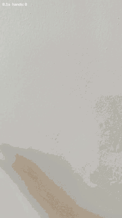

# Hand Detection & IoU Tracking

> 직접 촬영·라벨링한 손 이미지로 객체 탐지 모델을 미세조정하고, 프레임 간 바운딩 박스를 IoU로 연결해 손의 ID와 이동 궤적을 시각화한 컴퓨터 비전 프로젝트

**Keywords:** Python · YOLO · Object Detection · IoU · Multi-object Tracking · OpenCV · PyTorch (MPS) · Unit Testing



*시연 GIF는 결과 영상을 축소·저프레임으로 변환한 것입니다. 추론 속도를 나타내지 않으며, 탐지 누락과 ID 변경도 그대로 포함되어 있습니다.*

## 프로젝트 한눈에 보기

| 구분 | 내용 |
|---|---|
| 목적 | 영상 속 손을 탐지하고, 연속 프레임에서 같은 손에 ID를 유지하며 이동을 표시 |
| 데이터 | 직접 촬영·바운딩 박스 라벨링한 이미지 20장 (train 16 / validation 4) |
| 탐지 | 사전학습 YOLO26n의 단일 `hand` 클래스 미세조정 |
| 추적 | 이전·현재 프레임 박스의 IoU를 이용한 순차적 greedy 매칭 (임계값 0.5) |
| 결과 | 박스·ID·중심점·최근 30프레임 궤적을 영상에 시각화, 요약 JSON 저장 |
| 검증 | IoU 및 ID 매칭 관련 단위 테스트 9개, 실제 녹화 영상 분석 |
| 환경 | Python 3.11+, macOS, PyTorch MPS, Ultralytics, OpenCV |

이 프로젝트의 목표는 최첨단 추적기 성능을 주장하는 것이 아니라, **데이터 준비 → 탐지 모델 학습 → 프레임별 객체 연결 → 결과 분석**의 흐름을 직접 다루고, 탐지와 추적이 서로 다른 문제라는 점을 확인하는 것이었습니다.

## 내가 다룬 구현 내용

### 1. 이미지 데이터 준비와 탐지 모델 학습
- 손 사진 20장에 `hand` 바운딩 박스를 라벨링하고 16장/4장으로 분리했습니다.
- YOLO 형식의 이미지·라벨 쌍을 확인하고, 정규화된 바운딩 박스 좌표를 검사하는 데이터 준비 스크립트를 포함했습니다.
- YOLO26n의 사전학습 가중치를 활용해 손 단일 클래스 탐지 모델을 미세조정했습니다. YOLO 네트워크 자체를 새로 구현한 프로젝트는 아닙니다.
- macOS MPS 환경에서 학습하도록 batch 4, workers 0 등의 설정을 사용했습니다.

### 2. IoU를 활용한 프레임 간 손 추적
객체 탐지는 각 프레임에서 손의 위치를 찾는 일이고, **추적은 서로 다른 프레임의 탐지 결과가 같은 손인지 연결하는 일**입니다.

`compute_iou()`는 두 `xyxy` 바운딩 박스의 교집합 / 합집합 면적을 계산합니다. 면적이 0인 박스, 서로 닿기만 하는 박스, 잘못된 좌표와 같은 경계 조건을 처리합니다.

`Tracker.update()`는 다음과 같이 동작합니다.

1. 현재 프레임의 탐지 박스를 순서대로 확인합니다.
2. 아직 매칭되지 않은 이전 트랙 중 IoU가 가장 높은 박스를 찾습니다.
3. IoU ≥ 0.5이면 기존 ID를 유지하고, 아니면 새로운 ID를 부여합니다.
4. 이번 프레임에서 연결되지 않은 이전 트랙은 제거합니다.

같은 이전 트랙에 두 박스를 동시에 연결하지 않도록 일대일 매칭을 적용했습니다. 이 방식은 **검출 순서에 영향을 받는 greedy 방식**이며, 움직임 예측·전역 최적화·재식별(Re-ID)은 구현하지 않았습니다.

### 3. 영상 시각화와 재현 가능한 실행 흐름
- OpenCV로 박스, ID, 손 중심점, 최근 30프레임의 이동 궤적을 그립니다.
- 입력 영상에서 탐지된 프레임 수, 동일 ID의 최장 연속 유지 시간, 생성한 ID 수 등을 JSON에 기록합니다.
- 테스트 → 학습된 가중치 확인(없으면 학습) → 영상 추적을 실행하는 스크립트를 구성했습니다.
- `--self-test`로 실행 가능한 9개의 알고리즘 단위 테스트를 포함했습니다. GitHub Actions에서도 같은 테스트를 실행합니다.

## 실험 결과와 해석

### 손 탐지 모델 검증

**학습 조건:** 100 epochs, batch 4, image size 640, seed 42, workers 0, AMP off

| 지표 | 마지막 epoch (100) |
|---|---:|
| Precision | 0.98769 |
| Recall | 1.00000 |
| mAP@50 | 0.99500 |
| mAP@50:95 | 0.81217 |

기록상 최고 mAP@50:95는 **0.86425 (epoch 61–64)** 입니다. 다만 이것만으로 `best.pt`가 어느 epoch에서 선택됐는지 단정하지 않았습니다.

**해석:** 검증 이미지가 4장이고 촬영 조건도 비슷할 수 있기 때문에, 높은 수치를 실제 환경에서의 일반화 성능으로 해석하기 어렵습니다. 위 값은 **마지막 epoch의 학습 CSV에 기록된 검증 지표**이며, 별도의 독립 테스트셋 성능이 아닙니다.

원본 수치는 [results/training.csv](results/training.csv)와 [results 폴더](results/)에 보존했습니다.

### 실제 영상 추적 관찰

| 항목 | 기록된 결과 |
|---|---:|
| 영상 길이 / 프레임 | 약 8.77초 / 263프레임 |
| 손이 검출된 프레임 | 213프레임 (80.99%) |
| 연속 검출 최장 시간 | 약 3.90초 |
| 동일 ID 연속 유지 최장 시간 | 약 3.43초 |
| 생성된 ID 수 | 13개 |
| Detection confidence / Tracking IoU | 0.25 / 0.5 |

**해석:** 80.99%는 손이 검출된 **프레임 비율**이지 탐지 정확도나 recall이 아닙니다. 13개 ID도 실제 손이 13개 있다는 뜻이 아니라, 탐지 소실이나 위치 변화로 새로운 ID가 할당된 횟수가 포함된 결과입니다. 약 29.99 FPS는 **입력 영상의 재생 FPS**이지 추론 속도가 아닙니다.

추적 정답 ID 라벨이 없으므로 IDF1, MOTA 같은 정량적 추적 성능은 측정하지 않았습니다.

## 이 프로젝트에서 배운 점과 확인한 역량

아래 내용은 실제 구현과 실험 결과를 바탕으로 정리한 **기술적 학습 포인트**입니다.

**1. 객체 탐지 성능과 ID 추적 안정성은 별개다.**  
정지 이미지의 검증 지표가 높더라도 영상에서는 손 자세 변화, 검출 누락, 박스 위치 변화로 트랙 ID가 끊길 수 있었습니다. 탐지 모델을 평가하는 것과 시간에 따른 ID 유지 능력을 평가하는 것은 다른 작업임을 확인했습니다.

**2. 모델 성능 숫자보다 데이터 분할과 지표의 의미가 중요하다.**  
20장 중 4장만 검증에 사용했기 때문에 수치가 높아도 일반화를 단정하기 어렵습니다. 비슷한 촬영 장면이 train/validation에 나뉘면 평가가 낙관적으로 보일 수 있다는 한계도 파악했습니다.

**3. 알고리즘은 정상 동작뿐 아니라 경계 조건까지 검증해야 한다.**  
IoU 계산의 대칭성·겹침·퇴화 박스, 임계값 경계, 한 트랙에 대한 중복 매칭 방지, 검출 순서 변경, 손 소실 후 재등장 등 9개 테스트로 추적 로직의 기본 규칙을 확인했습니다. 단위 테스트 통과가 실제 영상의 추적 정확도까지 보장하지는 않습니다.

**4. 작은 모델 실험도 끝까지 실행하고 결과를 기록하는 경험이 중요하다.**  
데이터셋 구성, 학습 환경, 추적 영상 생성, JSON 요약, 실행 스크립트를 연결하며 실험 과정과 결과를 다른 사람이 확인할 수 있도록 정리했습니다.

### 현재 수준과 개선 방향

| 현재 한계 | 다음에 비교·검토할 방법 |
|---|---|
| 4장의 작은 검증셋, 유사 촬영 조건 | 다양한 배경·조명·거리·촬영 세션 확보, 세션 단위 데이터 분할 |
| 한 프레임만 놓쳐도 ID가 바뀜 | 미검출 트랙을 일정 프레임 유지하는 전략 |
| IoU만 사용하므로 큰 움직임에 취약 | 중심점 거리·움직임 예측 등을 비교 |
| greedy 매칭이 탐지 순서의 영향을 받음 | Hungarian matching 등 전역 매칭 방식과 비교 |
| 추적 정답이 없어 ID 성능 평가 불가 | ID가 라벨링된 영상으로 IDF1 등 평가 |

*오른쪽 항목은 향후 개선 아이디어이며 현재 구현·검증을 완료한 기능이 아닙니다.*

## 실행 방법

Python 3.11 이상과 macOS 터미널 기준입니다.

```bash
git clone https://github.com/choalbin010201/hand-detection-tracking.git
cd hand-detection-tracking
python3 -m venv .venv
source .venv/bin/activate
python -m pip install --upgrade pip
python -m pip install -r requirements.txt
```

`requirements.txt`는 버전 고정 파일이 아닙니다. 원래 실행 기록의 버전은 PyTorch 2.14.1 및 Ultralytics 8.4.189이며, 실행 환경에 따라 결과가 달라질 수 있습니다.

**알고리즘 테스트 (원본 데이터 불필요)**

```bash
python hand_tracking.py --self-test
```

**데이터 준비 (원본 데이터 별도 필요)**

직접 준비한 YOLO 라벨링 데이터가 있다면 `dataset/` 아래에 배치합니다.

```text
dataset/
  data.yaml
  images/train/  images/val/
  labels/train/  labels/val/
```

`data.yaml`은 `train: images/train`, `val: images/val`, `names: {0: hand}`를 정의합니다. 라벨 행은 정규화된 `class cx cy width height` 형식입니다.

새 CVAT YOLO 내보내기 데이터를 사용할 때만 아래 전처리를 실행할 수 있습니다. 대상 폴더가 이미 있으면 덮어쓰지 않습니다.

```bash
python prepare_dataset.py --source raw_dataset --output dataset --seed 42
```

이미지 단위 무작위 분할이므로 같은 촬영 세션의 유사 이미지가 서로 다른 분할에 섞일 수 있다는 점을 주의해야 합니다.

**학습 및 추적 (데이터·입력 영상 필요)**

```bash
# 최초 실행: 테스트 → 학습(필요시) → 영상 추적
python run_pipeline.py --source test.mp4

# 학습만 실행
python train_hand.py --epochs 100 --batch 4

# 학습된 가중치로 추적
python hand_tracking.py --source test.mp4 --weights "/path/to/best.pt"

# 옵션 예시
python run_pipeline.py --source test.mp4 --device cpu
python run_pipeline.py --source test.mp4 --retrain --batch 2
```

기본 장치는 MPS 사용 가능 시 MPS, 아니면 CPU입니다. 이 구현은 **녹화된 영상 파일**을 받으며 웹캠 숫자 입력은 지원하지 않습니다. 처음 사전학습 가중치를 받을 때 인터넷 연결이 필요합니다.

| 주요 출력 | 내용 |
|---|---|
| `runs/detect/hand_train*/` | 학습 가중치·학습 곡선·CSV |
| `latest_training.json` | 학습 모델 경로와 실행 환경 |
| `outputs/<실행시각>/hand_tracking.mp4` | 시각화 영상 (오디오 없음) |
| `outputs/<실행시각>/tracking_summary.json` | 추적 결과 요약 |

## 프로젝트 출처 및 기여 범위

대학교 **AI소프트웨어 과목에서 시작한 실습을 프로젝트 형태로 정리한 결과물**입니다. 수업에서 제공한 IoU·Tracker 스켈레톤 및 기본 greedy 추적 접근을 바탕으로 구현을 완성했습니다. 사전학습 YOLO 모델을 활용했으며 모델 아키텍처를 직접 만든 것은 아닙니다.

이 저장소에는 바운딩 박스 좌표 검사, 일대일 ID 연결, 테스트, 데이터 준비·학습·추적 실행 스크립트, 영상 시각화, 실험 수치 기록과 분석을 담았습니다. 코드 작성 및 정리에 생성형 AI의 도움도 활용했습니다. 따라서 모든 코드나 알고리즘을 독자적으로 고안했다고 주장하지 않습니다.

강의 PDF, 제출용 보고서, 학번, 원본 사진·영상, 학습 가중치는 저장소에 포함하지 않았습니다. 수업 유래 코드와 외부 의존성의 사용 조건을 일괄 재지정하지 않기 위해 별도의 오픈소스 라이선스를 선언하지 않았습니다.
