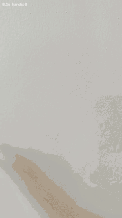

# Hand Detection & IoU Tracking

직접 촬영하고 라벨링한 손 사진으로 YOLO26n을 학습하고, 연속 프레임의 바운딩 박스를 IoU로 연결하는 학습 프로젝트입니다. macOS의 MPS 환경에서 학습·영상 추적을 실행했습니다.



영상에는 바운딩 박스, ID, 손 중심점과 최근 30프레임의 궤적이 표시됩니다. 위 GIF는 실제 결과 영상 전체를 축소·저프레임으로 변환한 것으로, 모델의 처리 속도를 나타내지 않습니다. 손을 놓치거나 위치가 크게 변하면 ID가 새로 부여되는 현상도 그대로 포함했습니다.

## 프로젝트 범위

- 손 사진 20장에 `hand` 클래스 바운딩 박스 라벨을 작성하고 train 16 / val 4로 분할했습니다.
- 사전학습 YOLO26n으로 단일 클래스 탐지 모델을 학습했습니다.
- `compute_iou()`와 detection 순서 기반 greedy 매칭을 구현했습니다.
- 박스의 ID·중심점·궤적을 표시하고 결과 영상과 요약 JSON을 저장합니다.
- IoU 경계 조건, 일대일 매칭, 검출 순서 변경, 소실·재등장을 다루는 테스트 9개를 포함합니다.

## 추적 방식

IoU = 두 박스의 교집합 면적 / 합집합 면적입니다. 좌표는 `(x1, y1, x2, y2)`이며 픽셀 인덱스의 `+1` 보정 없이 연속 좌표 면적을 사용합니다. 면적이 0인 박스의 IoU는 0입니다.

1. 현재 프레임의 검출을 순서대로 처리합니다.
2. 아직 연결되지 않은 이전 프레임 트랙 중 IoU가 가장 큰 후보를 찾습니다.
3. IoU가 0.5 이상이면 기존 ID를 유지하고, 그렇지 않으면 새 ID를 부여합니다.
4. 매칭되지 않은 이전 트랙은 즉시 제거합니다.

하나의 이전 트랙을 같은 프레임의 두 검출에 중복 연결하지 않습니다. 이 방식은 검출 순서의 영향을 받을 수 있으며, 전역 최적 매칭이나 움직임 예측, 재식별 기능은 없습니다. 한 프레임이라도 검출이 사라지면 재등장 시 새 ID를 받습니다.

## 실행

프로젝트 폴더를 VS Code에서 열고 macOS 통합 터미널에서 실행합니다. Python 3.11 이상을 사용합니다.

```bash
python3 -m venv .venv
source .venv/bin/activate
python -m pip install --upgrade pip
python -m pip install -r requirements.txt
```

`requirements.txt`는 실행 의존성 목록이며 완전한 버전 잠금 파일은 아닙니다. 원래 실행에서 보고된 버전은 PyTorch 2.14.1, Ultralytics 8.4.189입니다. 버전·장치·난수 처리에 따라 재실행 결과는 달라질 수 있습니다.

### 1. 알고리즘 테스트

```bash
python hand_tracking.py --self-test
```

이 테스트는 Python 표준 라이브러리만으로 실행됩니다. GitHub Actions도 동일한 9개 테스트를 실행합니다. 모델 학습이나 영상 정확도를 검증하는 테스트는 아닙니다.

### 2. 데이터 준비

원본 사진과 라벨, 학습 가중치는 저장소에 포함하지 않았습니다. 기존 과제 폴더의 `dataset` 폴더를 이 프로젝트 루트로 복사하면 기존 16/4 분할을 그대로 재사용할 수 있습니다. 디렉터리 구성은 아래와 같습니다.

| 경로 | 내용 |
|---|---|
| `dataset/data.yaml` | `train: images/train`, `val: images/val`, `names: {0: hand}` |
| `dataset/images/train/`, `dataset/images/val/` | 학습 / 검증 사진 |
| `dataset/labels/train/`, `dataset/labels/val/` | 사진과 동일한 이름의 YOLO `.txt` 라벨 |

라벨 한 줄은 정규화된 `class cx cy width height`이며 hand의 클래스 번호는 0입니다. `train_hand.py`가 데이터 루트를 현재 데이터 폴더로 설정하므로 과거 Mac의 절대경로를 YAML에 유지할 필요가 없습니다.

새로운 CVAT YOLO 내보내기 폴더를 준비한 경우에만 다음을 실행합니다. 기존 `dataset`을 덮어쓰지 않으며 새 출력 폴더가 필요합니다.

```bash
python prepare_dataset.py --source raw_dataset --output dataset --seed 42
```

입력에 `hand` 한 클래스를 정의한 `obj.names` 또는 YAML이 필요합니다. 이미지 중복, 라벨 좌표, EXIF 회전 등을 검사합니다. 이미지 단위 무작위 분할이므로 같은 촬영 장면이 양쪽에 섞일 수 있습니다.

### 3. 학습 및 영상 추적

프로젝트 루트에 별도로 촬영한 `test.mp4`를 넣습니다.

```bash
python run_pipeline.py --source test.mp4
```

처음에는 테스트 → 사전학습 가중치 다운로드 → 학습 → 영상 추적을 실행합니다. 이후에는 `latest_training.json`이 가리키는 가중치가 존재하면 재사용합니다. 최초 학습에는 인터넷 연결이 필요합니다.

```bash
# 학습만 실행
python train_hand.py --epochs 100 --batch 4

# 이미 학습한 best.pt로 추적 (경로를 실제 파일 위치로 변경)
python hand_tracking.py --source test.mp4 --weights "/path/to/best.pt"

# 화면 표시 / CPU 실행 / 다시 학습
python run_pipeline.py --source test.mp4 --show
python run_pipeline.py --source test.mp4 --device cpu
python run_pipeline.py --source test.mp4 --retrain --batch 2
```

MPS가 가능하면 자동 선택하고 그렇지 않으면 CPU를 사용합니다. 입력은 녹화 영상 파일이며 웹캠 번호 입력은 지원하지 않습니다. 학습 폴더를 이동하면 기록된 가중치 경로가 달라질 수 있으므로 `--weights`로 실제 위치를 지정하세요.

| 출력 | 내용 |
|---|---|
| `runs/detect/hand_train*/` | 가중치, 학습 곡선, CSV |
| `latest_training.json` | 실제 학습 위치와 환경 |
| `outputs/<실행시각>/hand_tracking.mp4` | 추적 결과 영상, 오디오 없음 |
| `outputs/<실행시각>/tracking_summary.json` | 프레임 수와 ID 연속 유지 시간 등 |

## 기록된 실험 결과

학습 설정은 100 epoch, batch 4, 입력 크기 640, seed 42, workers 0, AMP 비활성화입니다. 아래 검증 지표는 **마지막 epoch 100의 CSV 기록**입니다.

| 항목 | 값 |
|---|---:|
| 검증 Precision | 0.98769 |
| 검증 Recall | 1.00000 |
| 검증 mAP@50 | 0.99500 |
| 검증 mAP@50:95 | 0.81217 |
| 기록상 최고 mAP@50:95 | 0.86425 (epoch 61–64) |

CSV의 최고 지표만으로 실제 `best.pt`의 선택 epoch를 확정하지 않았습니다. 위 수치는 별도 테스트 이미지 평가나 `best.pt`를 다시 평가한 수치가 아닙니다. 원본 학습 수치는 [results/training.csv](results/training.csv), 설정과 분할은 [results](results/)에서 확인할 수 있습니다.

| 영상 추적 항목 | 값 |
|---|---:|
| 영상 길이 / 프레임 | 약 8.77초 / 263 |
| 손이 검출된 프레임 | 213 (80.99%) |
| 연속 검출 최장 시간 | 약 3.90초 |
| 동일 ID 연속 유지 최장 시간 | 약 3.43초 |
| 할당된 ID 수 | 13 |
| 탐지 confidence / 추적 IoU 임계값 | 0.25 / 0.5 |

80.99%는 검출 프레임의 비율이며 탐지 정확도나 recall이 아닙니다. 13개 ID는 실제 손이 13개라는 의미가 아닙니다. 시간은 프레임 수/FPS로 계산했으며, 영상의 약 29.99 FPS는 입력 영상의 재생 FPS이지 추론 처리 성능이 아닙니다. 추적 정답 라벨이 없어 IDF1·MOTA 등은 평가하지 않았습니다.

## 한계와 다음 개선

검증 이미지가 4장뿐이고 유사한 촬영 조건의 사진이 train/val에 섞일 수 있어 높은 검증 지표를 일반화 성능으로 해석하기 어렵습니다. 독립된 테스트 이미지 세트도 없습니다. 실제 영상에서는 손 자세 변화와 탐지 누락으로 ID가 바뀌었습니다.

향후 다른 배경·조명·거리·촬영 세션의 데이터를 늘리고 촬영 세션 단위로 분할할 계획입니다. 다음 단계로는 미검출 트랙을 잠시 유지하는 방식과 움직임 예측을 비교하고, 정답 ID가 있는 영상으로 ID 유지 성능을 평가할 수 있습니다. 이러한 개선은 현재 구현에 포함되어 있지 않습니다.

## 출처와 구현 범위

대학교 AI소프트웨어 과목 Week 6–7 실습에서 시작한 프로젝트입니다. 수업의 IoU·Tracker 스켈레톤과 기본 greedy 연결 방식을 바탕으로 완성했으며, YOLO 자체를 직접 구현한 것은 아닙니다. 이 저장소는 좌표 검사, 일대일 ID 매칭, 테스트, 데이터 준비, 실행 자동화, 결과 영상 및 통계 저장을 포함합니다. 코드 작성·정리 과정에 생성형 AI의 도움을 활용했습니다.

강의 PDF, 제출용 보고서, 학번, 원본 데이터 및 모델 가중치는 포함하지 않았습니다. 수업에서 유래한 코드와 외부 의존성의 이용 조건을 임의로 재지정하지 않기 위해 일괄적인 오픈소스 라이선스는 선언하지 않았습니다.

기존 과제 폴더에서 Git으로 옮기는 방법은 [docs/GITHUB_UPLOAD.md](docs/GITHUB_UPLOAD.md)를 참고하세요.
